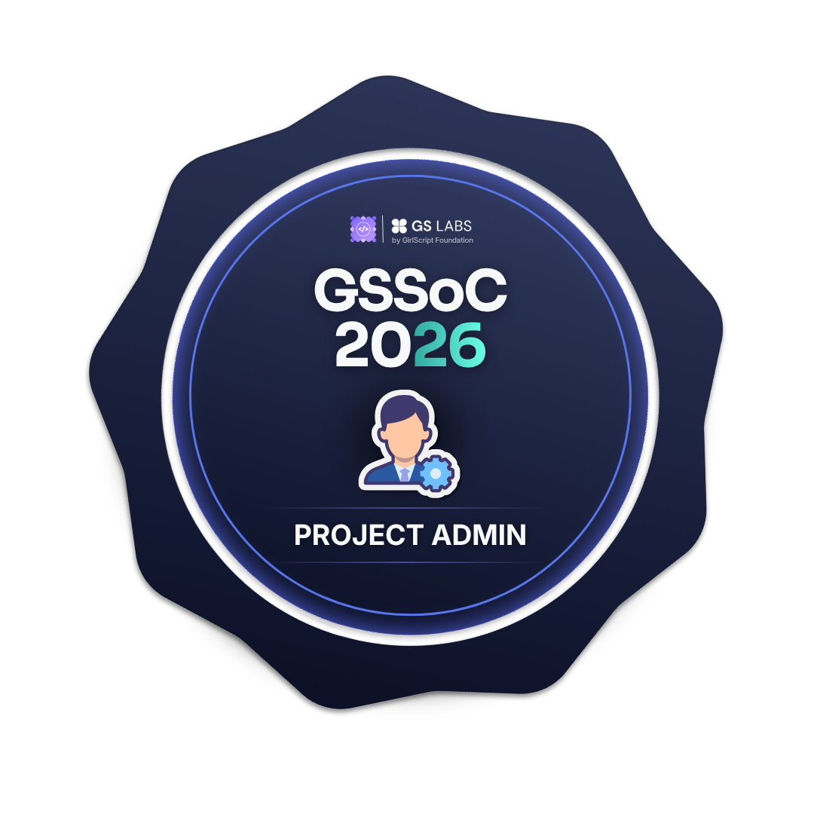
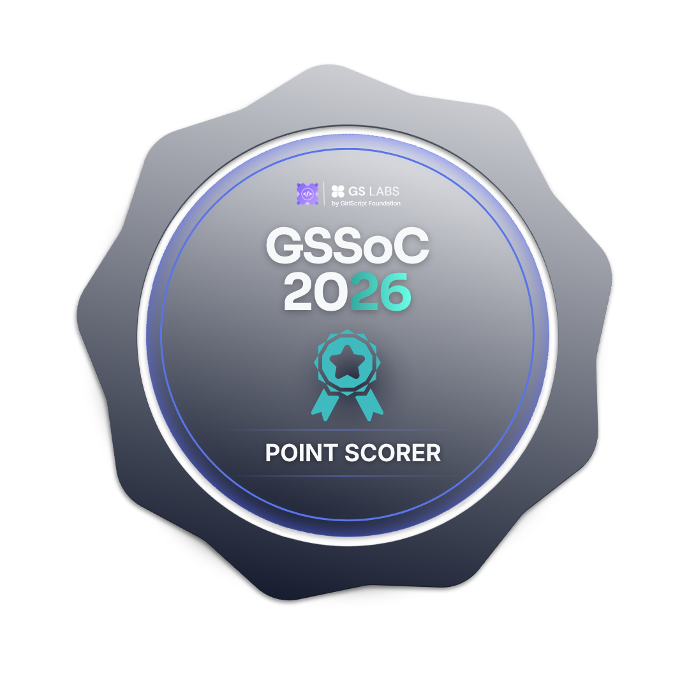
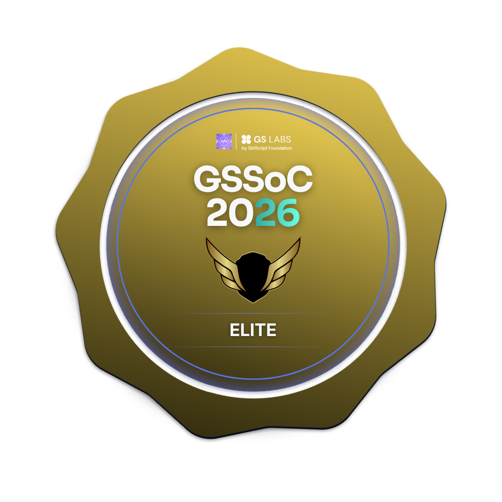

  

  

---

# 👋 About Me

I'm a B.Tech Information Technology student passionate about **Full-Stack Development, Data Analytics, Artificial Intelligence, and Open Source**. I enjoy building scalable web applications, solving Data Structures & Algorithms problems in Java, and transforming data into meaningful insights.

---

🌱 **Currently strengthening:** Data Structures & Algorithms, Core Computer Science subjects, and building AI- & Power BI-driven projects

🔭 **Currently building:** Full-Stack and AI-powered projects

💻 **Practicing:** Data Structures & Algorithms (Java) on LeetCode

🤝 **Looking to collaborate on:** Open-source projects, Full-Stack Development & AI

💬 **Ask me about:** Java, React, SQL, Power BI, Data Analytics, DSA

⚡ **Interests:** Web Development, Artificial Intelligence, Data Analytics, Open Source, Competitive Programming

💡 **My mantra:** *"Code clean, Build precise , and keep learning."*

---

### 🏆 Achievements & Badges
 

Hacktoberfest '25 Badges
 
<!-- Holopin Badges -->

<h3 align="center">🏆 GirlScript Summer of Code 2026</h3>

  
  
  
  
  
  
  

<b>Project Admin</b> • <b>Point Scorer</b> • <b>Rising Star • <b>Bounty Hunter • <b>Power Contributor• <b>Elite</b>

 

<!-- Custom Neon Achievement Badges -->

---

# 🧰 Tech Stack

### 💻 Languages
`Java` • `Python` • `JavaScript` • `SQL` • `HTML` • `CSS`

### 🚀 Frameworks & Libraries
`React` • `Node.js` • `Express.js`

### 🗄️ Databases
`MySQL` • `MongoDB`

### 📊 Data Analytics & AI
`Power BI` • `Pandas` • `NumPy` • `Matplotlib` • `Scikit-learn` • `PySpark` • `Dataiku`

### 🛠️ Tools
`Git` • `GitHub` • `VS Code` • `Postman` • `Jupyter Notebook` • `Figma`

---

### 📂 Highlighted Repositories

- 🌱 **[GrowCraft](https://github.com/anushkasark08/GrowCraft)** – Contributed 50+ commits towards enhancing features and improving the project.
- 🍽️ **[The Lighthouse](https://github.com/anushkasark08/The-Lighthouse)** – Full-stack restaurant management platform built using the MERN stack.
- 🤖 **AI Stock Market Analyzer** – Machine learning project for stock trend prediction and data visualization.
- 🌐 **PrepNinja** – AI-powered placement preparation platform for coding practice and interview readiness.
- 🎯 **Open Source Contributions** – Active contributor to **Hacktoberfest 2025**, **OSCI 2025**, **GirlScript Summer of Code (GSSoC)-2025 & 2026**

  ---
  
## 📈 GitHub Stats

Here's a snapshot of my GitHub activity, contribution streak, and the technologies I work with the most.

  
  

  

### ⚡ Fun Fact
> “Fueled by caffeine ☕ – can't code without it!”

### 📫 Connect With Me

<!-- Snake Game Repo View -->

  

